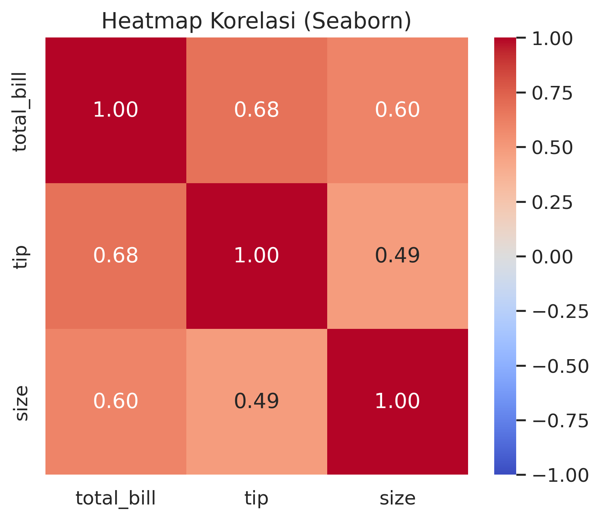

# Data Visualization Basics

Latihan membuat lima jenis grafik dengan Matplotlib dan Seaborn menggunakan dataset Tips, lalu membandingkan cara kerja kedua library. Proyek ini merupakan bagian dari latihan Data Analyst di [roadmap.sh](https://roadmap.sh/projects/data-visualization-tutorial).

## Ringkasan

Setiap jenis grafik dibuat dua kali, sekali dengan Matplotlib dan sekali dengan Seaborn, sehingga perbedaan sintaks dan hasilnya bisa dibandingkan langsung. Tujuan proyek ini adalah membiasakan diri dengan sintaks dan opsi kedua library, bukan analisis mendalam.

## Dataset

| Aspek | Keterangan |
|---|---|
| Sumber | Dataset Tips bawaan Seaborn, dimuat dengan `sns.load_dataset("tips")` |
| Ukuran | 244 baris, 7 kolom |
| Data kosong | Tidak ada |
| Kolom angka | `total_bill`, `tip`, `size` |
| Kolom kategori | `sex`, `smoker`, `day`, `time` |

Satu baris mewakili satu transaksi di restoran. Karena dataset ini bawaan Seaborn, tidak ada file data yang perlu diunduh.

## Teknologi

| Alat | Kegunaan |
|---|---|
| Python | Bahasa pemrograman |
| Pandas | Pengolahan data |
| Matplotlib | Visualisasi dasar dengan kontrol penuh |
| Seaborn | Visualisasi statistik yang lebih ringkas |
| Google Colab | Lingkungan kerja |

## Grafik yang Dibuat

| No | Grafik | Variabel | Temuan |
|---|---|---|---|
| 1 | Histogram | `total_bill` | Sebagian besar tagihan berada di kisaran 10 sampai 25 dolar, dengan puncak sekitar 15 sampai 17 dolar. Sebaran condong ke kanan |
| 2 | Bar chart | Rata-rata `tip` per `day` | Rata-rata tip cenderung lebih tinggi di akhir pekan: Minggu tertinggi (sekitar 3,25 dolar), Jumat terendah (sekitar 2,73 dolar) |
| 3 | Box plot | `total_bill` per `day` | Median tagihan naik dari Jumat (sekitar 15 dolar) ke Minggu (sekitar 20 dolar). Semua hari punya pencilan di sisi atas |
| 4 | Scatter plot | `total_bill` vs `tip` | Hubungan positif: makin besar tagihan, tip cenderung makin besar. Sebaran melebar pada tagihan besar |
| 5 | Heatmap | Korelasi `total_bill`, `tip`, `size` | Korelasi terkuat antara `total_bill` dan `tip` (0,68), disusul `total_bill` dan `size` (0,60), lalu `tip` dan `size` (0,49) |

Angka rata-rata dan median pada grafik 2 dan 3 dibaca dari grafik, sehingga hanya perkiraan.

## Contoh Hasil



## Perbandingan Matplotlib dan Seaborn

| Grafik | Matplotlib | Seaborn |
|---|---|---|
| Histogram | Batang saja, kurva kepadatan butuh langkah tambahan | Kurva ditambahkan dengan `kde=True` |
| Bar chart | Rata-rata dihitung manual dengan `groupby` | Menerima data mentah dan menghitung sendiri |
| Box plot | Data dipisah per hari secara manual | Cukup menyebut kolom |
| Scatter plot | Satu warna, kategori butuh perulangan | Warna per kategori dengan `hue` |
| Heatmap | Angka, label, dan warna teks dibuat manual | Satu baris dengan `annot=True` |

Seaborn lebih cepat untuk grafik statistik dari DataFrame karena menerima data mentah dan mewarnai berdasarkan kategori dengan satu parameter. Matplotlib lebih panjang, tetapi memberi kontrol penuh atas setiap elemen. Karena Seaborn dibangun di atas Matplotlib, keduanya bisa dipakai bersamaan.

## Kustomisasi yang Dicoba

| Yang diatur | Contoh |
|---|---|
| Judul dan label sumbu | `plt.title(...)`, `plt.xlabel(...)`, `plt.ylabel(...)` |
| Ukuran font | `fontsize=14` untuk judul, `fontsize=11` untuk label |
| Ukuran grafik | `figsize=(7, 4)` |
| Palet warna | `viridis` (bar chart), `Set2` (box plot), `coolwarm` (heatmap) |
| Tema | `sns.set_theme(style="whitegrid")` |
| Menyimpan gambar | `plt.savefig(..., dpi=300, bbox_inches="tight")` |

## Keterbatasan

- Proyek ini hanya latihan sintaks, jadi temuan di atas tidak dimaksudkan sebagai analisis mendalam.
- Dataset hanya berisi 244 transaksi dari satu restoran, sehingga pola yang terlihat belum tentu berlaku umum.
- Korelasi menunjukkan keterkaitan, bukan sebab-akibat.

## Struktur Repositori

```
Data-Visualization-Basics/
├── images/
│   └── heatmap_korelasi_seaborn.png
├── data-visualization-basics.ipynb
└── README.md
```

## Cara Menjalankan

| Langkah | Yang dilakukan |
|---|---|
| 1 | Instal library: `pip install pandas matplotlib seaborn jupyter` |
| 2 | Buka notebook dengan `jupyter notebook` |
| 3 | Jalankan semua sel dari atas ke bawah |

`sns.load_dataset("tips")` mengunduh data lewat internet saat dijalankan, jadi pastikan koneksi aktif.

## Tautan

| Item | Tautan |
|---|---|
| Notebook di Colab | [isi tautan notebook Colab] |
| Halaman proyek | https://roadmap.sh/projects/data-visualization-tutorial |

## Penulis

[Rehana Putri Salsabilla]
